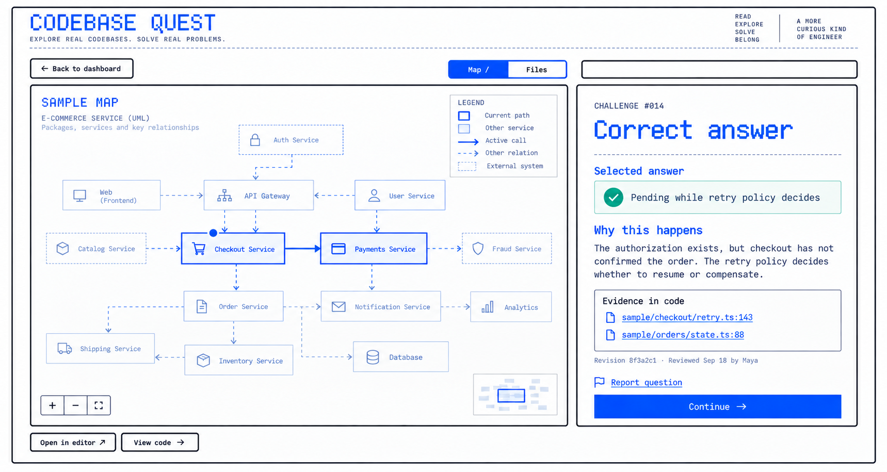

# Francisco Botta

Systems engineer, Argentina. Ex-DevOps. Co-founded a cold-email agency and was its CTO (closed 2026).

## Oct–Nov 2026: mapping the limits of understanding

I'm exploring how LLMs can generate **adaptive artifacts that speed up the
formation of real mental models**. I'm the test subject: I learn technical
systems with them and write down what works and what doesn't.

### What I believe so far (hypotheses, not results)

- **Relevance first.** Learn from today's real problems, not from a syllabus.
- **Theory plus practice.** Every concept needs an explanation and a chance to apply it.
- **Calibrate fast.** Find the frontier of what you understand. It's a fog of war that keeps moving.
- **The UI adapts to the discipline,** not the other way around.
- **Trust comes from sources.** If the material isn't reliable, nothing else matters.
- **Memory.** The agent can't derive who you are, what you know or what you decided, so it has to be stored.

### Prototypes (private proofs of concept; none is good enough yet)

| Prototype | What it does | For whom |
|---|---|---|
| **MindLayer** | Prepares reading for a learning objective and keeps what you've shown you understand. | An engineer learning a codebase or a book. |
| **Memory plugin** | Stores what an agent can't derive: who you are, what you know, what you've decided. | Anyone learning with coding agents (today: me). |
| **Mind-Digger** | Reads your past agent sessions, finds recurring friction, turns it into study material. | Engineers who ship with agents and suspect they're stacking shallow fixes. |
| **Codebase Quest** | Short challenges linked to real code, tests and decisions. Unvalidated. | Teams onboarding people or rotating on-call. |
| **Teaching System / Learning Loop** | A tutor that picks the next blocking uncertainty and asks for a prediction before answering. A terminal reader with recall and spaced repetition. | Someone learning a repo or a book. |
| **UML viewer plugin** | An interactive architecture viewer inside the agent conversation, based on Uncle Bob's UML viewer. | Developers who want to see the structure next to the chat. |

  
   Codebase Quest mockup, sample data.

### Public

- [key-tunnel](https://github.com/3ottA/key-tunnel): Windows keyboard on Linux over one persistent SSH session (Rust).

X: [@franciscobotta_](https://x.com/franciscobotta_) · LinkedIn: [/in/francisco-botta](https://www.linkedin.com/in/francisco-botta/)
